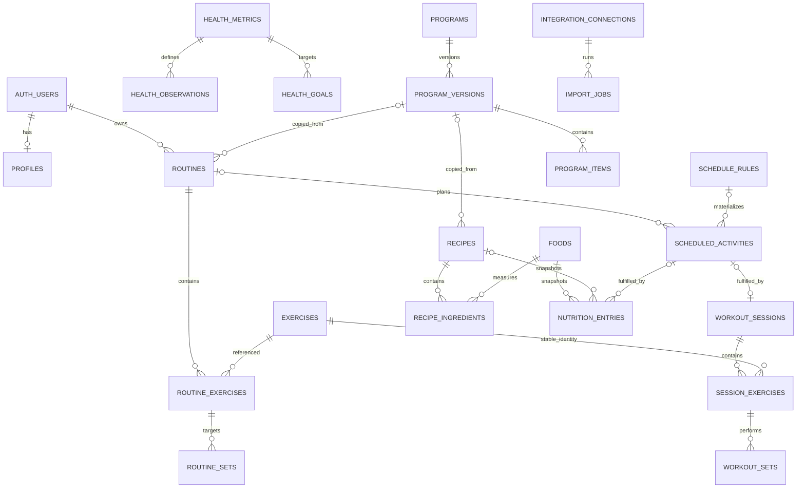

# Form architecture

Status: Phase 5 deployment preparation, October 16, 2026. Workouts, nutrition, health, calendar and dashboard use real Supabase persistence. Migrations 001-009 are deployed without resets; all 27 tables retain RLS and 35 policies. Fifteen authenticated-only invoker RPCs cover diary, planning and fulfillment. Public signup/email confirmation was verified in Phase 2. See `NUTRITION.md` for intake/import rules and `HEALTH-CALENDAR.md` for health, recurrence and timezone semantics.

## Application boundaries

Next.js App Router and strict TypeScript provide routing and rendering. Tailwind v4 provides styling; checked-in shadcn-style Button/Card components use CVA, Radix Slot, and shared class merging. Recharts renders analytics with accessible text descriptions. The responsive shell exposes Dashboard, Workouts, Nutrition, Calendar, Progress, Community, and Settings.

`src/lib/demo/data.ts` supplies explicit `/demo/dashboard`, `/demo/calendar`, `/demo/workouts`, `/demo/progress`, `/demo/nutrition` previews and deferred Community content. Demo changes remain temporary component state. Real dashboard/calendar/health contain no fictional measurements or arbitrary fitness scores.

`/`, `/calendar`, `/health`, `/workouts`, `/workouts/[id]`, `/nutrition`, `/progress`, and `/settings` are private, database-backed routes. They use server-only typed repositories and explicit authorization. Errors never fall back to fixtures. Root rendering is dynamic; personalized responses are never prerendered, and the configured proxy applies `private, no-store` caching.

`src/lib/supabase/server.ts` creates a request-scoped, typed SSR client with cookie storage and a public publishable key. `src/proxy.ts` follows the current Supabase SSR integration: `getClaims()` refreshes/cryptographically validates the cookie session and propagates refreshed request/response cookies plus cache headers. `getViewer()` independently calls `getUser()` on the server and is memoized only within the React request. Private pages and every server action verify identity again; neither cookie presence nor client-supplied ownership is accepted as authentication. Anonymous users are redirected to login; unconfigured/unreachable authentication displays a setup/connection state. There is no service-role client, privileged public key, fabricated identity, or application database bypass.

Email/password signup, login, resend confirmation and current-device logout are server actions. Registration uses an isolated public-key client without PKCE or session persistence: Supabase confirms the email, then `/auth/callback` discards the implicit URL fragment using an explicit empty fragment redirect. The user must log in with their password through the cookie-based SSR client. This supports confirmation in a different browser without accepting URL tokens as an application session. Legacy PKCE code exchange remains supported. The callback uses a fixed configured origin with no arbitrary return URL. Signup enforces at least eight characters and Supabase's 72-byte UTF-8 limit without transforming passwords; login supports credentials created under earlier minimum policies. Provider error codes produce bounded, helpful messages without returning provider internals. Supabase retains confirmation, rate limiting and password hashing. Password recovery remains deferred. The default hosted mailer restricts recipient addresses; custom SMTP is needed for arbitrary assessor signup. Configure redirects/email delivery as described in `SETUP.md`.

`src/lib/training` owns typed documents, Zod validation, template copying, calculations, and the server-only repository. Server actions validate unknown input, derive the owner from the verified identity, and call invoker-security RPCs. `database.types.ts` is generated by introspecting the actual migrated PostgreSQL schema, not handwritten casts or fixtures. The repository paginates each owner-scoped read in 500-row batches so the API row cap does not silently truncate records or lifetime PRs. Loading the full personal strength history is a deliberate phase-2 tradeoff; a future large-data phase should move aggregations into indexed SQL and load history by cursor.

## Relational model

All primary identifiers are UUIDs, except the controlled health metric dictionary. All private descendants carry `owner_id`. Composite foreign keys `(parent_id, owner_id)` prevent attaching another user's parent even when its UUID is known. Cross-owner references are allowed only for authorized catalog entries and program provenance, guarded by invoker-security triggers.

| Domain            | Tables                                                               | Relationships and invariants                                                                                                                                                                                                                                                                                         |
| ----------------- | -------------------------------------------------------------------- | -------------------------------------------------------------------------------------------------------------------------------------------------------------------------------------------------------------------------------------------------------------------------------------------------------------------- |
| Identity          | `profiles`                                                           | One private profile per `auth.users` ID; display name, timezone, and preferred display units. No public health or profile access.                                                                                                                                                                                    |
| Exercise catalog  | `exercises`, `exercise_favorites`                                    | Twenty migration-owned common strength exercises with fixed IDs; built-in rows have null owner and are read-only to clients; custom rows and favorites are private. Search/filter by muscle group, equipment, and favorite. Archive referenced exercises.                                                            |
| Workout templates | `routines`, `routine_exercises`, `routine_sets`                      | A routine owns ordered exercise slots; each slot has ordered target sets including reps, kg, RPE/RIR, and rest. Live template edits do not update past sessions.                                                                                                                                                     |
| Workout records   | `workout_sessions`, `session_exercises`, `workout_sets`              | Session timestamps, notes, title snapshot, source, optional template/schedule links; exercise slots preserve stable exercise ID, name, and tracking type snapshots; each performed set retains reps, kg, time, distance, RPE/RIR, type, and completion timestamp.                                                    |
| Nutrition catalog | `foods`                                                              | Nullable macro values per 100 g, description, portions, selected additional nutrients, source URL/import timestamp, revision, brand, source and external ID. Built-in and user-owned access follow the exercise catalog model.                                                                                       |
| Meal templates    | `recipes`, `recipe_ingredients`, `food_favorites`                    | Ordered ingredient quantities in grams, recipe yield in servings, instructions, independent personal copies, food favorites. Current recipe values are computed from current ingredients; past entries use immutable composition/nutrient/serving basis snapshots. Recipe favorites use a separate owner-safe table. |
| Nutrition records | `nutrition_entries`, `nutrition_goals`                               | An entry is a food, recipe, or fully manual record. It preserves name, entered quantity/unit, converted grams, and total kcal/protein/carbs/fat for that exact quantity. Historical goal periods preserve earlier targets. Source, external ID, and verification timestamp accommodate future label scanning.        |
| Planning          | `schedule_rules`, `scheduled_activities`                             | Recurrence rules describe intent; materialized occurrences preserve template snapshots and timezone. Rules reference a workout or recipe template. Unique `(rule_id, occurrence_date)` makes daily materialization idempotent. Multiple occurrences per day per rule require a future occurrence-key migration.      |
| Health diary      | `health_metrics`, `health_observations`, `health_goals`              | Typed metric definitions define canonical units, accepted ranges, and aggregation. Repeated observations retain timestamp, local date, timezone, source, and external ID. Goal periods are separate from observations.                                                                                               |
| Community         | `programs`, `program_versions`, `program_items`, `program_favorites` | Creator-owned program identity; unique numbered versions; ordered day-offset items with self-contained, format-versioned JSON snapshots. Only explicitly public, published versions/items are readable by others. Favorites refer to specific versions.                                                              |
| Integrations      | `integration_connections`, `import_jobs`                             | Server-owned connection metadata and idempotent jobs. Client can read only its own status. Tokens are excluded and must live in a vault.                                                                                                                                                                             |

The JSON documents in scheduled occurrences and published program items are immutable copies of domain templates, not an alternative operational database. Exercise slots, performed sets, recipe ingredients, observations, and diary entries remain relational. The future publication/copy service must validate snapshot format, copy custom catalog entities into the recipient's ownership, and materialize relational personal templates in one transaction. It must never depend on access to the creator's private routine or recipe rows.

## Historical integrity and transactions

Templates, scheduled occurrences and completed records form a directional lineage. Ad hoc workouts need no schedule. Composite owner/kind FKs protect references. At most one workout draft/session and one consumed recipe entry fulfill an occurrence. Strength save/delete RPCs and meal fulfillment/delete triggers update linked status atomically. SQL derives immutable template/nutrient snapshots; plans never count toward actual performance/intake. Calendar starts the existing logger. See `HEALTH-CALENDAR.md` for finite recurrence, explicit exceptions and clock-skew handling.

`save_strength_routine(jsonb)` saves a routine and ordered target rows in one transaction. `save_strength_workout(jsonb)` saves a draft or completed session, exercise slots, and sets in one transaction. It derives names/tracking-type snapshots from readable catalog rows on first insertion and preserves existing trusted snapshots on corrections/reordering. It never trusts names supplied by the browser. `delete_strength_workout(uuid, integer)` deletes only the caller's matching revision and cascades child rows. Template deletion is archival, retaining historical and planned references. A copied routine has independent IDs/content.

Routine and session `revision` fields support optimistic concurrency. Stale writes fail with `PT409`; failed child writes roll back the parent and revision. Caller-generated UUIDs prevent a timed-out create from becoming a duplicate record on retry. Existing slot/set UUIDs survive workout edits. Completed sessions cannot be silently changed back into drafts.

The logger serializes autosaves and uses the last acknowledged revision. It debounces changes by 1.2 seconds, validates before submitting, and marks success only after the database confirms. Starting a session immediately persists a draft, so it can be resumed later. Finish requires at least one completed, valid set. An in-flight save completes before deletion reads the current revision. Device recovery is keyed by user/session UUID, is offered explicitly rather than auto-uploaded, and is removed after acknowledged save/discard or current-user logout. A stale device copy requires deliberate restoration against the current server revision. Local recovery is a convenience for validated drafts, not encrypted offline storage or a background sync queue; the UI discloses device storage. Network/authorization/conflict errors retain unsaved edits and do not pretend success.

Preserve snapshots at creation within the same transaction as child rows. A logged food uses totals for the consumed quantity, not a mutable catalog lookup. A published version cannot be updated or deleted, and its item rows cannot be inserted, moved, edited, or deleted after publication. Draft item changes lock the parent version to serialize against concurrent publication. Create a new version for changes. Current publication visibility is also frozen; withdrawal, moderation, privacy erasure, and removal of accounts with published versions require a controlled maintenance migration/service before public launch. Do not expose account deletion until that lifecycle is implemented.

Personal copies retain `source_version_id` but own independent content. Referenced templates/catalogs are protected by restrictive FKs; archive instead of deleting. Owners may explicitly correct their own diary records; preservation means template edits cannot rewrite history, not that users lose control of their records. A future correction audit can record revisions if needed.

Constraints enforce nonnegative amounts, effort ranges, ordered positions, valid statuses, positive servings, and completion after start. Strength validation additionally bounds exercises/sets, names/notes, repetitions (integers up to 1,000), external loads (0–2,000 kg), effort, UUID uniqueness, IANA timezone, and timestamp order. RPCs independently validate core invariants and require completed sets before finishing. RPE is optional in half steps from 0–10; RIR is optional in integer steps from 0–10. Health observation triggers enforce metric-specific ranges. Nutrition goal overlap and food/quantity plausibility checks are implemented in SQL and validation. Bounded weekly recurrence and occurrence exceptions are implemented; community snapshot payload validation remains future work.

## Units, dates, analytics, and imports

- Canonical storage: kg, cm, meters, seconds, ml, kcal, and grams of macronutrients. Sleep observations use minutes as declared by the metric dictionary. Recipe conversions resolve to grams; display conversions never mutate stored history.
- Store UTC instants with `timestamptz`; retain time zones for workouts, health, nutrition, and planned occurrences, plus explicit local dates for health/nutrition. Services must supply the user's IANA timezone explicitly rather than relying on the database's UTC default or server-local time.
- Exercise history and PRs derive from completed sets in completed sessions, grouped by stable exercise ID and stored tracking-type snapshot. Exclude warm-up and incomplete sets by default; include working/drop/failure sets. Volume is the sum of external kg × repetitions. Highest-load PR accepts positive-repetition external-load sets, including sets above 12 reps. Estimated 1RM uses the actual load for 1 rep, and Epley `weight × (1 + reps / 30)` for 2–12 reps. Exclude zero load, invalid reps, sets above 12 reps, and reps-only/bodyweight exercises from estimates. Display rounds estimates to one decimal; calculations retain full precision. Dumbbell load is the entered load, used consistently rather than automatically doubled. Comparisons use the latest two recorded sessions; the logger shows only earlier completed sessions, excluding itself. These estimates are not tested maximums. Rep-specific records and more advanced progression recommendations remain future work.
- Daily health aggregation uses metric semantics. Imported daily totals from multiple providers must not be blindly summed with manual totals. Phase 6 will introduce a source-priority/overlap policy and interval metadata before wearable ingestion is enabled.
- Unique `(owner_id, source, external_id)` applies to workout/nutrition imports; observations additionally include metric code. Null external IDs permit repeated manual entries. External IDs must be normalized/namespaced by the connector. Jobs have unique connection/idempotency keys.
- Missing data is distinct from zero. Do not fill absent weight or sleep samples with zero in analytics. Add date-bounded, owner-scoped views or queries once real repositories exist. Avoid redundant mutable PR or daily-summary tables until performance warrants them.

## Security

Every public-schema application table enables RLS. Explicit grants plus policies define access; anonymous users have only shared catalogs, metric definitions, and deliberately public published program snapshots. Authenticated users can manipulate only their own diary/template rows. Global catalog inserts, provider tokens, import jobs, and connection mutations are not browser operations. Private profiles are never joined into public sharing implicitly.

Policies use `(select auth.uid())`; there are no SECURITY DEFINER application functions or service-role clients in application code. Standalone, explicitly invoked hosted verification scripts use authorized CLI admin access only for disposable fixture lifecycle and metadata audits. Reference guards supplement RLS because foreign key checks alone do not enforce visibility. Owner-first history indexes support common queries and policy filtering. Favorites explicitly revoke inherited Supabase default privileges before granting SELECT/INSERT/DELETE. Business revision conflicts use PT409 rather than retryable serialization code 40001. Trusted catalog import tooling separately uses authorized CLI database access to upsert shared official foods; no app client can perform that operation. Schema migrations are the only source of truth; migrate forward after deployment. Do not weaken policies to bypass application errors.

All nine versioned migrations execute in the PGlite harness and an isolated native PostgreSQL 17 cluster. Both bootstrap only Supabase's database roles, minimal `auth.users`, and `auth.uid()` boundary, then test actual grants, RLS, two identities, anonymous access, transactions, invalid children, snapshots, revisions, stable catalog IDs, favorites, imports, publications, and deletion. The native harness uses a random loopback port and generated SCRAM credential, never an existing database, verifies persistence after reconnecting, and stops/removes its owned cluster. This isolated harness simulates the auth boundary; separate hosted tests exercise the real Supabase Auth/API service. The harness reproduces hosted default table grants, including TRUNCATE, before testing explicit privilege revocation.

Pure domain tests cover calculations, dates, validation, IDs, and independent copies. Vitest/UI tests exercise set editing and autosave ordering/recovery/conflicts with an explicitly mocked transport. Chromium tests cover desktop/mobile demos, anonymous private-route protection, setup states, navigation, and 404s. The real Supabase API integration and authenticated desktop/mobile browser workflow have passed against the configured hosted project. `test:hosted` provisions two admin-confirmed disposable fixtures using existing CLI authority, then runs ordinary public-key login/RLS access and removes only those fixture accounts. A separate `verify-signup.mjs` run used the approved inbox and real confirmation email, without admin confirmation. Verification credentials remain in tooling process memory; live traces/videos/screenshots are disabled. See `SETUP.md`.

## Extension points

1. Auth: verified email/password/confirmation/refresh/logout lifecycle against hosted Supabase; next password recovery, confirmation resend, account export/deletion, and opt-in public identity. Profiles remain private; no public email projection.
2. Workouts: larger-history query optimization, supersets, rest timers, richer PR categories, configurable display units, and duration/distance cardio. Existing strength templates, autosave/recovery, comparisons, and PR calculations are implemented and hosted persistence is verified.
3. Nutrition: servings, recipe yields, saved meals, source provenance, official Norwegian cache, dated goals and historical diary are implemented; next scheduled refresh, server search/aggregates at scale, cooking-yield controls, offline sync, and verified scans.
4. Health/calendar: manual metrics, dated goals, 7/30/90-day charts, bounded DST-safe recurrence, exceptions, atomic fulfillment and live daily summaries are implemented. Next: date-bounded queries, optional rolling schedules and provider overlap resolution before wearable ingestion.
5. Community: validated version publishing, attribution/moderation, withdrawal and erasure lifecycle, public profile projection, transactional copy/materialization, and public rate limiting. No private diary publication.
6. Integrations: scoped OAuth in a vault, signed webhook verification, queue retries, provider-specific normalization, source overlap resolution, and user-controlled disconnect/deletion.

Upstream references: installed Next.js 16 documentation in `node_modules/next/dist/docs`, [Supabase SSR](https://supabase.com/docs/guides/auth/server-side/creating-a-client), [Supabase RLS](https://supabase.com/docs/guides/database/postgres/row-level-security), and [Supabase user management](https://supabase.com/docs/guides/auth/managing-user-data).

## Deployment boundary

The Next.js server targets Vercel (Node 24, repository root, cloud build), using the existing hosted Supabase project. The user approved private GitHub publication, production deployment and necessary fixes. The private repository is https://github.com/BuzzDot/DAVE3625-MA3. Local public config remains in ignored .env.local; only public Supabase URL/key and the fixed production origin are set in Vercel. Administrative verification tooling, local credentials, tests and migrations are excluded from CLI uploads. The migration exclusion is root-anchored so it cannot exclude `src/lib/supabase`. Git deployments remain disabled. See DEPLOYMENT.md for current release results.

Security headers add framing/MIME/base/object restrictions, disable indexing and omit X-Powered-By; the limited CSP is not a full script-source policy. Existing verified auth, cookie refresh and no-store behavior remain unchanged. Independent production acceptance requires FORM_TEST_BASE_URL, starts no local server and uses disposable fixtures. Actual email confirmation is checked separately. See DEPLOYMENT.md and SUBMISSION.md.
